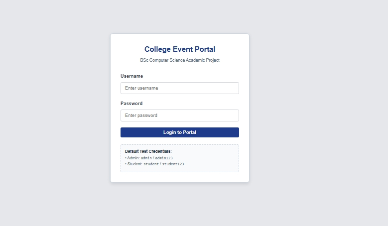
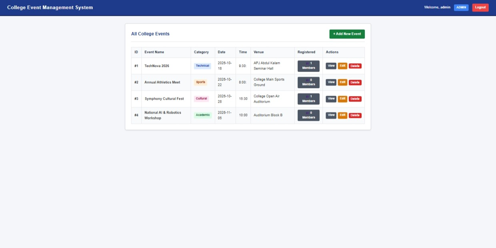
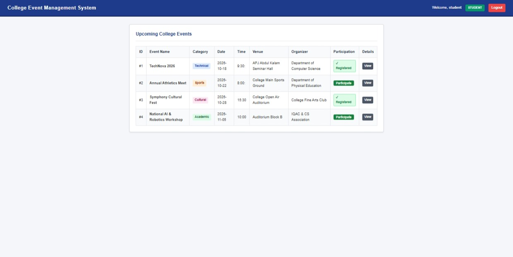
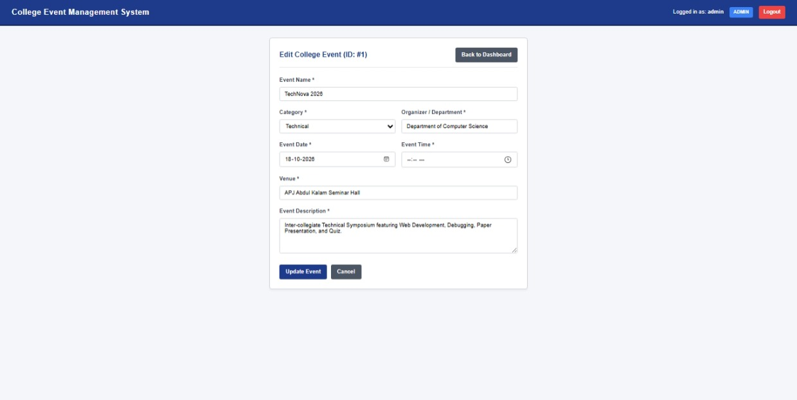

# College Event Management System 🎓

A complete, simple, and clean **College Event Management System** web application developed using **Python, MySQL, HTML, and CSS**. Built strictly at a **BSc Computer Science academic project level** with role-based access control (Admin & Student).

---

## 📌 Project Overview
- **Project Title:** College Event Management System
- **Technologies Used:** Python, MySQL, HTML, CSS (No external frameworks, No JavaScript)
- **Target Audience:** College Administration & Students
- **Architecture:** Client-Server model using Python's built-in `http.server` and MySQL relational database.

---

## 📸 Screenshots & UI Preview

### 1. Role-Based Login Portal


### 2. Admin Dashboard (Full CRUD & Live Participants Count)


### 3. Student Portal (Browse Events & One-Click Participation)


### 4. Registered Participants List (Admin View)


---

## ✨ Features

### 1. 🛡️ Role-Based Access
The system provides two distinct user roles:

#### A. Admin Role
- **Secure Login:** Dedicated credentials authentication.
- **Event Management (Full CRUD):**
  - **Create:** Add new college events with title, category, date, time, venue, organizer, and description.
  - **Read:** View full list of scheduled events and detailed event pages.
  - **Update:** Edit existing event information anytime.
  - **Delete:** Remove events from the system with a single click.
- **👥 View Registered Participants:** Admin can see how many and which students have clicked to participate in each event (student username and registration timestamp).

#### B. Student Role
- **Student Login:** Access the student event portal.
- **Browse Events:** View upcoming events and category tags.
- **View Event Details:** View complete information for any event.
- **🎉 Event Participation:** Click the **"Participate"** button to register for an event. Once registered, the status immediately shows `✓ Registered` and duplicate registrations are automatically prevented.
- **Security Protection:** Students cannot access admin URLs (`/admin/dashboard`, `/admin/add-event`, `/admin/edit-event`). Attempting to do so redirects back safely.

---

## 🛠️ Technologies Used
- **Backend:** Python (Standard library `http.server`, `urllib.parse`, `http.cookies`)
- **Database:** MySQL
- **Database Connector:** `mysql-connector-python`
- **Frontend:** Pure HTML5 & CSS3 (Zero JavaScript, Zero external CSS frameworks)

---

## 📂 Project Folder Structure

```text
college_event_system/
│
├── database.sql           # MySQL script for database, tables & sample data
├── db_config.py           # MySQL connection configuration file
├── server.py              # Main Python web server (handles HTTP requests & logic)
├── .gitignore             # Standard gitignore file
│
├── static/
│   └── style.css          # Clean, student-level CSS stylesheet
│
└── templates/             # Pure HTML view templates
    ├── login.html
    ├── admin_dashboard.html
    ├── student_dashboard.html
    ├── add_event.html
    ├── edit_event.html
    ├── event_details.html
    └── view_participants.html
```

---

## 🗄️ Database Structure

Database Name: `college_event_db`

### 1. `users` Table
Stores login credentials and assigned roles.
- `user_id` (INT, Primary Key, Auto Increment)
- `username` (VARCHAR(50), Unique)
- `password` (VARCHAR(50))
- `role` (VARCHAR(20)) — `'admin'` or `'student'`

### 2. `events` Table
Stores all event details.
- `event_id` (INT, Primary Key, Auto Increment)
- `event_name` (VARCHAR(100))
- `event_description` (TEXT)
- `event_date` (DATE)
- `event_time` (TIME)
- `venue` (VARCHAR(100))
- `organizer` (VARCHAR(100))
- `event_category` (VARCHAR(50)) — Cultural, Sports, Technical, Academic, Other

### 3. `event_participants` Table
Bridge table storing student event registrations.
- `registration_id` (INT, Primary Key, Auto Increment)
- `event_id` (INT, Foreign Key -> `events.event_id`)
- `user_id` (INT, Foreign Key -> `users.user_id`)
- `registered_at` (TIMESTAMP)
- Unique Key: `(event_id, user_id)` (prevents duplicate registrations)

---

## 🚀 Setup and Run Instructions

Beginners-ku project-ah setup panni run panna easy-aana step-by-step instructions:

### Step 1 — Python Check
First unga system-la Python install aagirukanum
Command Prompt (CMD) open panni indha command run pannunga:
```bash
python --version
```
> *Python 3.8 or higher version display aana sari.*

---

### Step 2 — MySQL Setup
1. MySQL Workbench, MySQL Command Line Client, or XAMPP Control Panel-la MySQL-ah start pannunga.
2. Project folder-la irukura `database.sql` file-la ulla SQL code-ah copy panni MySQL-la execute pannunga, alladhu CMD-la:
```bash
mysql -u root -p < database.sql
```
> *Idhu `college_event_db` database, 3 tables (`users`, `events`, `event_participants`), and sample data-va create pannidum.*

---

### Step 3 — Database Configuration
Unga local MySQL password-ah configure panna:
1. `db_config.py` file-ah open pannunga.
2. `DB_CONFIG` dictionary-la unga MySQL password-ah kudunga:
```python
DB_CONFIG = {
    'host': 'localhost',
    'user': 'root',
    'password': 'your_mysql_password',  # XAMPP default-na password empty-a '' vekkalaam
    'database': 'college_event_db',
    'port': 3306
}
```

---

### Step 4 — Project Open
VS Code open panni `File` -> `Open Folder` click panni, indha `college_event_system` folder-ah select pannunga.

---

### Step 5 — Required Package Install
Indha project-ku ore oru library mattum thaan thevai:
VS Code terminal alladhu CMD-la indha command run pannunga:
```bash
pip install mysql-connector-python
```

---

### Step 6 — Run the Project
VS Code terminal alladhu CMD-la project folder path-la irundhu indha command type panni Enter pannunga:
```bash
python server.py
```
Terminal-la:
```text
============================================================
College Event Management System is running!
URL: http://localhost:8000
Press Ctrl + C to stop the server.
============================================================
```
nu vandhaa server successfully start aaiduchu!

---

### Step 7 — Browser-la Open Panna
Chrome, Edge or Firefox browser open panni indha address-ku ponga:
```text
http://localhost:8000
```

---

### Step 8 — Test Login Credentials

| Role | Username | Password | Access Rights |
|---|---|---|---|
| **Admin** | `admin` | `admin123` | Add, Edit, Delete events, View event participants list |
| **Student** | `student` | `student123` | View events, View details, Click "Participate" button |

---

### Step 9 — Stop Server
Application stop panna terminal-la **`Ctrl + C`** press pannunga. Server stop aaidum.

---

## 🛠️ Basic Troubleshooting (Problems & Solutions in Tanglish)

#### 1. `'python' is not recognized as an internal or external command`
- **Reason:** Python PATH environment variable-la add aagalai.
- **Solution:** Python reinstall pannum bodhu bottom-la irukura **"Add Python to PATH"** checkbox-ah tick pannitu install pannunga.

#### 2. `MySQL connection error` / `Can't connect to MySQL server`
- **Reason:** MySQL service run aagalai.
- **Solution:** XAMPP use panna `MySQL` Start button click pannunga. Normal MySQL-na Windows Services (`services.msc`)-la poyi `MySQL` service running-la iruka nu check pannunga.

#### 3. `Access denied for user 'root'@'localhost'` (Wrong password)
- **Reason:** `db_config.py`-la kudutha password thavara iruku.
- **Solution:** `db_config.py` open panni `password` field-la unga correct MySQL root password-ah enter pannunga.

#### 4. `Unknown database 'college_event_db'`
- **Reason:** Database create panna marandhuteenga.
- **Solution:** `database.sql` script-ah MySQL-la run panni database-ah create pannunga.

#### 5. `Table 'college_event_db.events' doesn't exist`
- **Reason:** Database create aanaalum tables create aagalai.
- **Solution:** `database.sql`-la ulla `CREATE TABLE` queries-ah MySQL-la run pannunga.

#### 6. `No module named 'mysql'`
- **Reason:** MySQL connector install aagalai.
- **Solution:** Terminal-la `pip install mysql-connector-python` run pannunga.

#### 7. `OSError: [WinError 10048] Only one usage of each socket address` (Port in use)
- **Reason:** Port 8000-la already vera software run aagudhu.
- **Solution:** `server.py` file-la `PORT = 8000` irukuradha `PORT = 8080` alladhu `PORT = 5000` nu maathitu browser-la `http://localhost:8080` open pannunga.

#### 8. `Login not working / Invalid username or password`
- **Reason:** Users table-la sample accounts add aagalai.
- **Solution:** `database.sql`-la irukura sample user INSERT queries execute aagiruka nu check pannunga (`admin` / `admin123`).

---

## 🎓 Academic Viva  Explanation Guide

**Q1: What is the architecture of this project?**  
> *"It follows a standard Client-Server architecture. The backend is written in pure Python using `http.server`, managing HTTP GET and POST requests, session cookies, and MySQL CRUD operations. The frontend consists of pure HTML5 forms and custom CSS with zero JavaScript."*

**Q2: How is role-based authentication implemented?**  
> *"When a user logs in, Python queries the `users` table to match username, password, and retrieve their role. On success, an HTTP-only session cookie is set. Every subsequent request checks the role before allowing Admin actions (Add, Edit, Delete, View participants), effectively protecting routes from unauthorized student access."*

**Q3: How does the event participation feature work?**  
> *"We designed a Many-to-Many relationship between students and events using the `event_participants` bridge table. When a student clicks 'Participate', a record `(event_id, user_id)` is created. A composite UNIQUE constraint prevents duplicate entries."*
